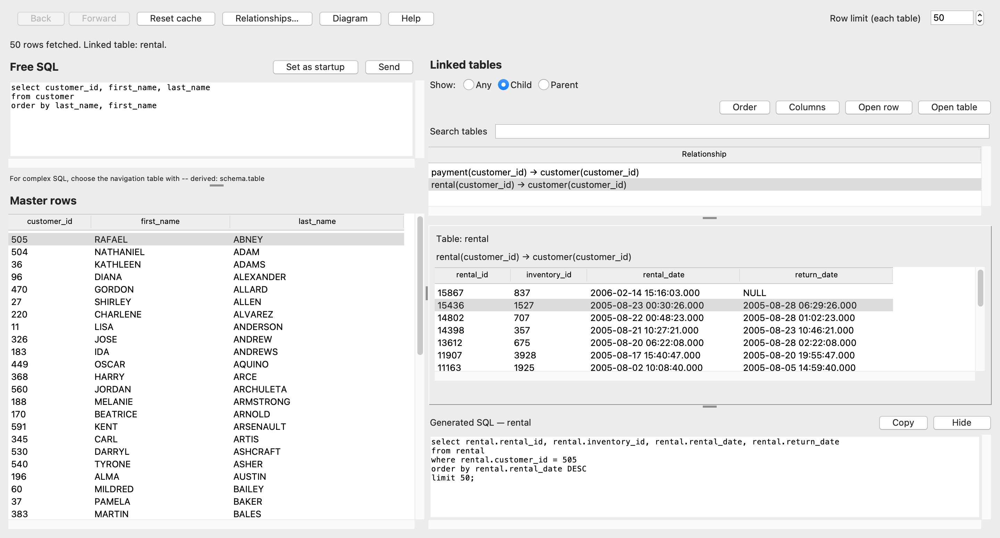
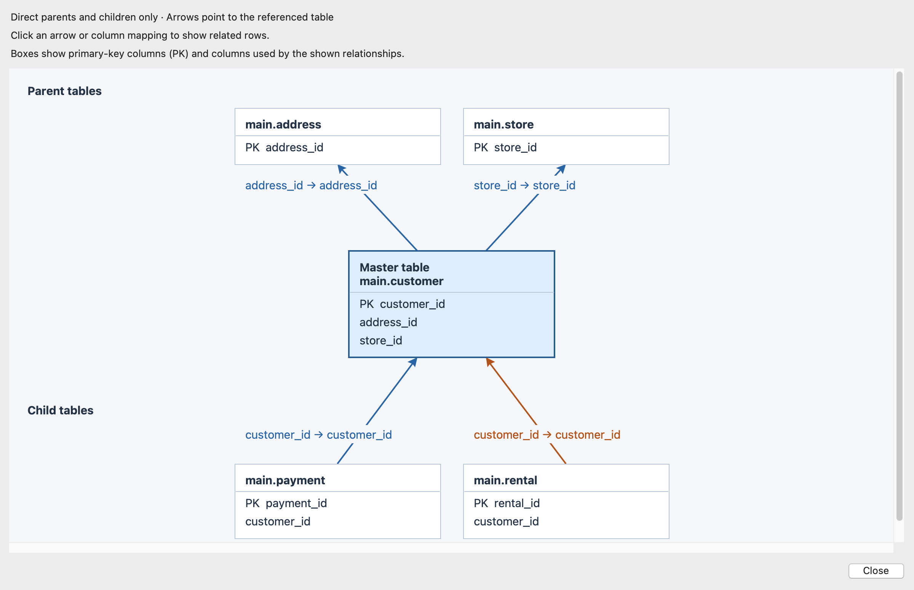

# Database Navigator

A Python desktop application for exploring SQLite and PostgreSQL databases
through their relationships. Run a SELECT query, select a row, and follow parent
or child links to inspect related records.

Browsed databases are read-only. A separate local SQLite database stores
application preferences and custom relationship declarations.

## Screenshots

Browse customers and their rentals, with the generated relationship query visible:



See a table's direct parents and children, including the columns linking them:



Both screenshots show the Sakila sample database on macOS. Demo data comes from
[Bradley Grant's SQLite port of Sakila](https://github.com/bradleygrant/sakila-sqlite3/tree/9394b42d13888c3d3d3d56cd7e9c84fadafb71c7),
originally developed by the MySQL team, with port credits to jOOQ and DB Software
Laboratory. The upstream repository contains its license and source notices.

## Setup

Install Python 3.14 or newer with tkinter available from your Python/system
installation. Use the `.sh` scripts on macOS/Linux (Bash required), or the `.bat`
scripts in Windows Command Prompt.

Clone the repository, optionally with only its latest history. Replace
`<repository-url>` with this repository's Git clone URL:

```sh
git clone --depth 1 <repository-url> database-navigator
cd database-navigator
```

On macOS/Linux:

```sh
./setup-env.sh
```

On Windows, ensure Python is on PATH, then use Command Prompt:

```bat
setup-env.bat
```

Setup creates or reuses `.venv` and installs psycopg 3, the PostgreSQL driver.
It does not install Python or tkinter. To select a particular Python executable:

```sh
PYTHON=python3.14 ./setup-env.sh
```

In Windows Command Prompt, `PYTHON` can be an executable path (without additional
arguments):

```bat
set "PYTHON=C:\Path\To\Python314\python.exe"
setup-env.bat
```

Run setup again after updating the application if its dependencies change.
There is no need to activate the environment: both launchers use `.venv` directly.

## Launch

Pass a connection string and optionally a model name:

```sh
./launch.sh --model example 'CONNECTION STRING'
```

The model is a name you choose for a database structure. It enables saved
preferences, startup SQL, and custom relationships. If omitted, `--model` uses
`default`. Connections using the same model and application database share these
settings; choose distinct model names for unrelated databases. Custom relationships are defined through
**Relationships…** with a model; importing relationship files is not supported.

### SQLite

Open an existing file using an absolute path (four slashes before the path):

```sh
./launch.sh --model example 'sqlite:////absolute/path/example.sqlite'
```

Or use a path relative to the cloned project directory:

```sh
./launch.sh --model example 'sqlite:///data/example.sqlite'
```

The file must already exist. It is opened read-only; the application does not
create the database you want to browse.

### PostgreSQL

Use a libpq connection string with your own host, database, and user:

```sh
./launch.sh --model example 'host=localhost port=5432 dbname=example user=reader'
```

PostgreSQL connection URLs also work:

```sh
./launch.sh --model example 'postgresql://reader@localhost:5432/example'
```

On Windows, use double quotes around connection strings:

```bat
launch.bat --model example "host=localhost port=5432 dbname=example user=reader"
launch.bat --model example "postgresql://reader@localhost:5432/example"
```

Use normal libpq credential mechanisms such as `.pgpass` instead of embedding
passwords in commands or scripts. Prepare any required VPN/proxy connection
yourself. The application uses read-only PostgreSQL transactions.

### Windows SQLite example

Use forward slashes in the SQLite connection string, with three slashes before
an absolute Windows drive path:

```bat
launch.bat --model example "sqlite:///C:/Data/example.sqlite"
launch.bat --model example "sqlite:///data/example.sqlite"
launch.bat --help
```

The second example is relative to the cloned project directory. As on macOS/Linux,
the database file must already exist.

### Options and file locations

```sh
./launch.sh --help
./launch.sh --version
./launch.sh --model example --application-database /absolute/path/preferences.sqlite \
  'sqlite:////absolute/path/example.sqlite'
```

The launcher forwards all arguments to the app and runs from the cloned project
directory, even when invoked from elsewhere. Relative paths are resolved there.
By default, model preferences are stored in `database-navigator.sqlite` in that
directory. This file must be separate from the database being browsed. Keep it
private: it can contain saved SQL and database relationship details.

The window title shows the application version. Use `launch.bat --version` on
Windows to print it without opening a window or connecting to a database.

## Browse data

Enter a SELECT query for one of your tables in **Free SQL**, then click **Send**.
Select a master row and a relationship to see related rows. **Child**, **Parent**,
and **Any** filter relationship direction. **Open table** and **Open row** move
related data into the master view; **Back** and **Forward** navigate history.

- Composite foreign keys and relationships across PostgreSQL schemas are supported.
- **Relationships…** manages additional local relationship declarations when
  using a model, without changing database constraints.
- **Diagram** shows the current table's direct relationships.
- **Columns** and **Order** customize related-table queries for a model.
- **Generated SQL** shows the query used to retrieve related rows.
- **Set as startup** saves editor text for a model. Startup never runs it automatically.
- **Help** lists keyboard shortcuts.

Return navigation key columns under their original names. For complex SQL, a
comment such as `-- derived: public.orders` identifies the navigation table.
Generated PostgreSQL SQL requires unquoted lowercase identifiers. **Open row**
requires a declared primary key; views can have custom relationships but cannot
use Open row. SQLite UI browsing uses the `main` schema.

See [changelog.md](changelog.md) for user-visible changes.
